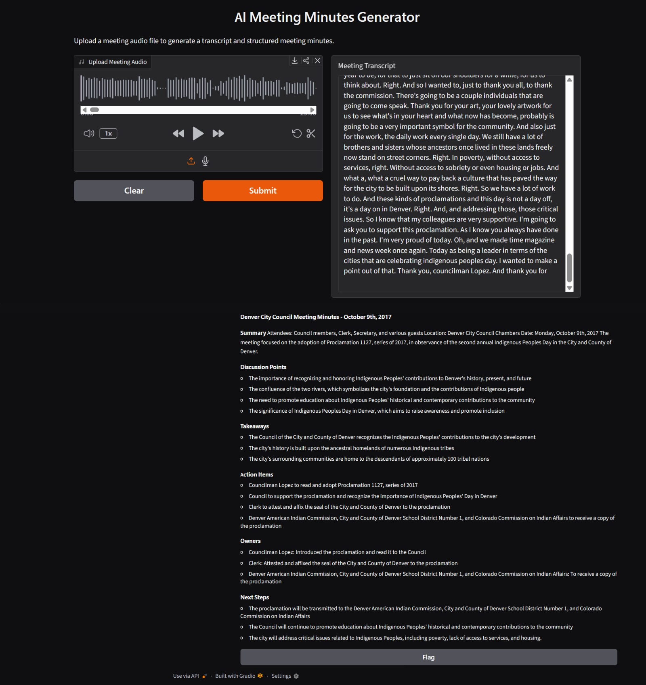

# Meeting_Minutes_Generator
A meeting transcription and summarization system that converts audio recordings into structured meeting minutes. It uses Whisper and OpenAI for speech-to-text transcription, Llama for generating meeting summaries, and Gradio for an interactive interface where users can upload audio files and view the results.

## Objective
To simplify the process of documenting meetings by automatically converting spoken discussions into readable transcripts and organized meeting minutes, including key discussion points, takeaways, action items, and assigned responsibilities.

## Steps Followed

1. **Environment Setup**
   - Installed the required Python libraries, including Transformers, PyTorch, BitsAndBytes, OpenAI, and Gradio.
   - Configured Hugging Face authentication and GPU access in Google Colab.

2. **Audio Preparation**
   - Used a Denver City Council meeting recording as the sample input.
   - Loaded the audio file for transcription and meeting analysis.

3. **Speech-to-Text Transcription**
   - Used Whisper (`whisper-medium.en`) through Hugging Face Transformers to transcribe the meeting audio.
   - Implemented OpenAI's `gpt-4o-mini-transcribe` as an alternative transcription method.
   - Displayed both transcription results for comparison.

4. **Prompt Preparation**
   - Created system and user prompts to guide the meeting-minute generation.
   - Specified the required output structure, including a summary, discussion points, takeaways, and action items with owners.

5. **Llama Model Configuration**
   - Configured 4-bit quantization using BitsAndBytes to reduce GPU memory usage.
   - Loaded the Llama model using Hugging Face Transformers.
   - Generated structured meeting minutes from the transcript.

6. **Streaming Text Generation**
   - Used `TextIteratorStreamer` to stream generated text progressively.
   - Used Python threading to support streaming while the model generated the response.

7. **Gradio Interface Development**
   - Created an interface for uploading meeting audio files.
   - Connected transcription and meeting-minute generation into one workflow.
   - Displayed the meeting transcript and generated minutes in separate output sections.

8. **Application Testing**
   - Tested the workflow using the Denver City Council meeting recording.
   - Reviewed the generated transcript and meeting minutes, including discussion points, action items, owners, and next steps.

## Gradio Interface
The Gradio application provides an audio upload component, a meeting transcript display, and a meeting-minutes output section. Users can submit a recording and view the generated summary and action items through the interface.

### Application Screenshot

## Outcome
- Developed a meeting transcription and summarization workflow that processes audio recordings and produces structured meeting minutes.
- The project demonstrates speech recognition, prompt engineering, quantized language model inference, streaming text generation, and Gradio interface development.
